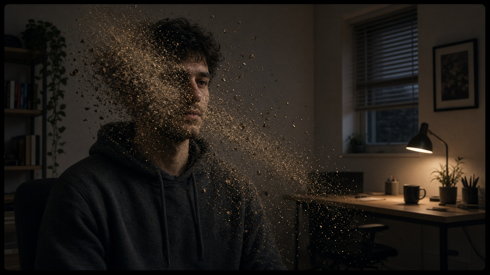
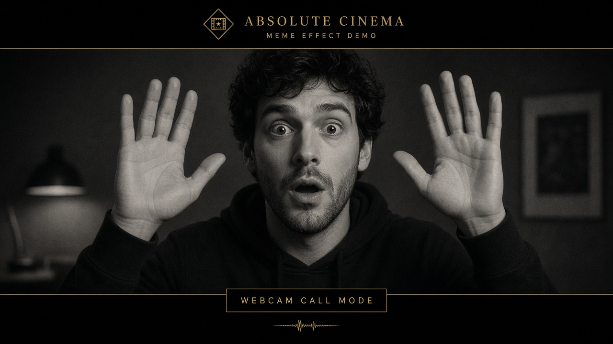

<p align="center">
  
</p>

<h1 align="center">Snap &amp; Cinema FX</h1>

<p align="center">
  <strong>Chrome extension for cinematic webcam effects in Google Meet and any web video call.</strong><br>
  Snap your fingers to vanish into dust. Raise both hands for Absolute Cinema.<br>
  Everyone on the call sees the effect — not just you.
</p>

<p align="center">
  <a href="#install"></a>
  
  
  
</p>

<p align="center">
  
</p>

---

## What it does

Snap & Cinema FX sits between your camera and the website. Sites like Google Meet, Zoom Web, Teams Web, and Discord Web receive a processed video stream — so effects are visible to everyone on the call.

| Gesture | Effect |
|--------|--------|
| **Finger snap** | You dissolve into drifting ash. Snap again to reassemble. |
| **Double snap** | Cash rain — banknotes flutter down the frame. |
| **Both hands up** | Absolute Cinema — letterbox, grain, and your live face in the meme. |
| **Hand over face** | Facepalm meme fades in at 50% over you. |

---

## Features

### Vanish into dust

Make a clear finger snap on camera. You turn to ash while your room stays visible. Snap again and the dust flies back together.



### Absolute Cinema

Raise both hands beside your head. The frame goes black-and-white with letterbox bars, film grain, and the Absolute Cinema title — with your live face mapped onto it.



### Cash rain

Snap twice quickly (within about a second). Notes rain from the top of the frame for a few seconds.


### Extra controls

- **Background blur** — use the extension’s blur instead of Meet’s (Meet’s blur smears effects)
- **Custom memes** — swap Absolute Cinema / Facepalm images from the popup
- **Snap sensitivity** — Low / Normal / High
- **Fix backwards self-view** — un-mirrors Meet’s preview so text reads correctly
- **Debug mode** — draw tracking dots on video (others see it too — turn off after testing)
- **Keyboard shortcuts** (focus the call tab first):
  - `Alt` + `Shift` + `S` — snap / vanish
  - `Alt` + `Shift` + `C` — Absolute Cinema
  - `Alt` + `Shift` + `M` — cash rain
  - `Alt` + `Shift` + `F` — facepalm

---

## Install

Takes about two minutes. No store listing required.

1. **Clone or download** this repo and keep the folder somewhere permanent (don’t delete it after loading).
   ```bash
   git clone https://github.com/JTarakRam/snap-cinema-fx.git
   ```
2. Open Chrome and go to `chrome://extensions`
3. Turn on **Developer mode** (top-right)
4. Click **Load unpacked** and select the `snap-cinema-fx` folder (the one that contains `manifest.json`)
5. Pin the extension from the puzzle-piece icon
6. Reload any Meet (or other call) tab that was already open

---

## How to use

1. Open Google Meet (the pre-join self-view is ideal for testing).
2. Make sure your hands are clearly in frame and the room is well lit.
3. Try a **finger snap** for vanish, **both hands up** for Absolute Cinema, or open the popup to tweak settings.

### Tips for the best effect

- **Let it learn your background.** Lean out of frame for a second or two after the camera turns on so the room plate is clean when you vanish.
- **Good light + hand visible.** Snap detection uses hand tracking; dark rooms or a hand half out of frame get missed. The mic snap sound also helps confirm.
- **Sensitivity.** Missed snaps → set High. Accidental triggers → set Low.
- **Don’t stack Meet’s blur.** Turn Meet’s blur off; use “Blur my background” in the extension popup instead.
- **Toggle timing.** Turning effects on/off applies the next time the call starts the camera — toggle camera off/on or reload the tab.

---

## Privacy

Everything runs **locally on your computer**. MediaPipe models are bundled in the extension. No video or audio leaves your machine except through the call itself. The mic is only analysed locally for the snap sound.

---

## How it works

| File | Role |
|------|------|
| `inject.js` | Wraps `getUserMedia` so the page gets a processed camera track |
| `engine.html` / `engine.js` | Hidden extension frame: MediaPipe hands + pose, dust particles, cinema grade |
| `bridge.js` | Connects the page inject script to the engine |
| `popup.html` / `popup.js` | Settings UI |
| `manifest.json` | Chrome MV3 extension config |
| `models/` | Bundled MediaPipe models |
| `memes/` | Default Absolute Cinema & Facepalm images |

---

## Requirements

- Google Chrome **111+** (or Chromium-based browsers that support MV3 + WASM)
- A webcam
- GPU acceleration recommended for smooth video

---

## Author

**Tarak Ram** ([@JTarakRam](https://github.com/JTarakRam))

Built as a fun local Chrome extension for web video calls.

---

## License

MIT — see [LICENSE](LICENSE).
